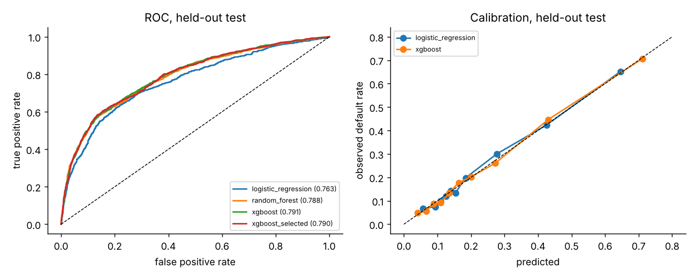
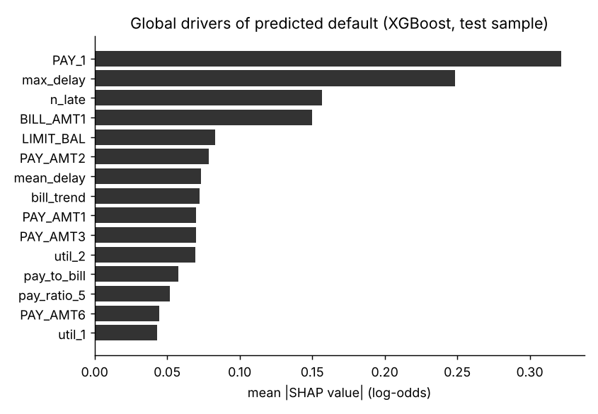
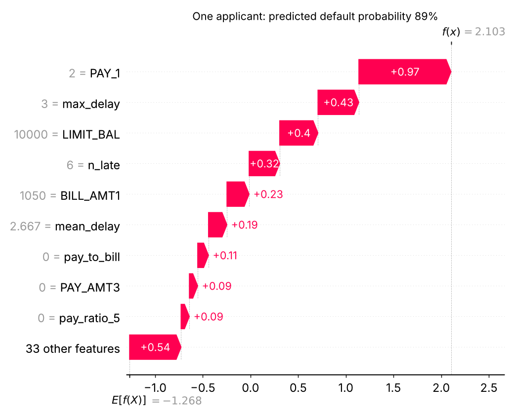

# Credit default: evaluating a model I can explain and stress-test

A small, reproducible study on a **public** credit dataset. It asks one question: *can a gradient-boosted
model predict default well, and can I show that the result is trustworthy rather than just high?*

This is a public-data reproduction of methods I use on credit risk work. It is **not** client work, and none of
the numbers below come from a client model.

Author: Ayo Ogunkola

## What it does

1. **Model comparison** (logistic regression, random forest, XGBoost) with 5-fold CV on the training split only,
   then **one** evaluation on a held-out test set.
2. **Feature selection inside the pipeline** (`SelectFromModel`, median threshold), so it is re-fitted in every fold.
3. **Leakage checks**: a demonstration of why selecting features before cross-validation inflates results, and a
   screen that catches an input which secretly encodes the label.
4. **Explanations that are checked, not just drawn**: SHAP additivity verified, SHAP compared with permutation
   importance, and stability of the top features across seeds.
5. **Slice check** on attributes deliberately excluded from the model (sex, age band).
6. **Single-row inference latency**, measured on artefacts reloaded from disk.

## Data

"Default of Credit Card Clients" (Yeh & Lien, 2009, UCI Machine Learning Repository, CC BY 4.0), 24,000-row copy
from the PyCaret datasets folder. The target is **observed default** next month, not a vendor score.
23,976 rows after dropping 24 exact duplicates; 22.1% default rate. Downloaded on first run.
Sex, age and marital status are never model inputs; they are used only for the slice check.
42 inputs: raw payment history, bills and payments, plus engineered utilisation, repayment ratios and delinquency counts.

Yeh, I. C., & Lien, C. H. (2009). The comparisons of data mining techniques for the predictive accuracy of
probability of default of credit card clients. *Expert Systems with Applications, 36*(2), 2473-2480.

## Run it

```bash
pip install -r requirements.txt
python -m src.run        # about 1-2 minutes on 2 CPUs; writes results/
pytest -q tests
```

## Results (seed 42; re-run to confirm on your machine)

Held-out test, evaluated once:

| model | ROC AUC | PR AUC | KS | Brier |
|---|---|---|---|---|
| logistic regression | 0.763 | 0.518 | 0.415 | 0.140 |
| random forest | 0.788 | 0.565 | 0.440 | 0.133 |
| XGBoost | 0.791 | 0.560 | 0.447 | 0.133 |
| XGBoost + feature selection | 0.790 | 0.564 | 0.449 | 0.132 |

- **Boosting vs random forest is a tie.** The 0.003 AUC gap is smaller than the fold-to-fold spread (SD about
  0.009). Both clearly beat logistic regression.
- **Feature selection halved the inputs (42 to 21) with no measurable loss** (CV AUC 0.784 vs 0.783).
- **Latency** (single row, in-process, 2 vCPU sandbox, p50 / p95): logistic regression 0.9 / 1.3 ms, XGBoost
  2.6 / 3.5 ms, XGBoost with selection 2.0 / 2.8 ms, random forest 15 / 19 ms. Selection cut p95 by about 21%.
  The random forest artefact is about 19 MB against about 0.3 MB for XGBoost.



### Leakage checks

| check | result |
|---|---|
| Pure noise, features selected **before** CV | AUC **0.854** (should be 0.5) |
| Pure noise, selection **inside** the CV pipeline | AUC **0.505** |
| Feature that encodes the label, added to the model | test AUC 0.791 -> **0.950**; the feature takes 76% of total gain |
| Single-feature AUC screen | flags only the leaky feature; nothing flagged on the clean data (max 0.72) |
| Row-order sanity check (is the index informative?) | AUC 0.49, no signal |

The first row is the one that matters: a model can look excellent when feature selection has seen the labels.
Keeping selection inside the pipeline is what makes the 0.79 above believable.

### Explanations



- Latest repayment status (`PAY_1`), maximum delay and count of late months dominate, which is sensible for this data.
- SHAP values add up to the model output (max error 2.6e-06).
- SHAP and permutation importance agree on 8 of the top 10 features (Spearman 0.89).
- Top-10 features are fairly stable across 5 seeds (mean Jaccard 0.83), so individual rankings below the top few
  should not be over-read.



### Slice check (not a fairness guarantee)

| slice | n | observed default | mean predicted | AUC | approval rate* |
|---|---|---|---|---|---|
| female | 2,898 | 20.5% | 21.5% | 0.780 | 81.7% |
| male | 1,898 | 24.5% | 23.3% | 0.804 | 77.3% |
| age <30 | 1,596 | 23.2% | 23.6% | 0.784 | 77.9% |
| age 30-44 | 2,393 | 19.9% | 20.7% | 0.789 | 82.6% |
| age 45+ | 807 | 26.3% | 23.8% | 0.801 | 76.5% |

*Approving the lowest-risk 80% overall. Approval rates differ across groups and follow the observed default-rate
differences, but the model under-predicts for the 45+ and male groups (23.8% vs 26.3%; 23.3% vs 24.5%).
Excluding the attributes does not remove proxies. A real deployment would need a fairness policy and a proper review.

## Serving it (FastAPI + Docker)

The `xgboost_selected` pipeline is also served as an API: `src/api.py` (FastAPI), `src/record.py` (single-record features), `Dockerfile` (multi-stage, trains in the build stage, non-root runtime).

```bash
python -m src.train_export                 # writes artifacts/ (model, model card, sample requests)
uvicorn src.api:app --port 8000           # or: docker build -t credit-api . && docker run -p 8000:8000 credit-api
curl localhost:8000/docs                  # request schema; POST /predict?explain=true returns top-3 reason codes
python -m src.loadtest --url http://localhost:8000
```

Design choices:
- **Inputs are validated and unknown fields rejected**, so SEX, AGE and MARRIAGE cannot be sent as inputs (tested).
- **Same numbers as offline**: a test checks API probabilities against the offline predictions, and a parity test checks the fast feature path against the pandas path on 200 held-out rows.
- **Model card and version** in every response; request logs hold ids, timings and risk band only, never inputs.
- Risk bands are illustrative, not a credit policy.

### Latency (measured, local uvicorn, 2 vCPU sandbox, client on the same machine)

Where time goes for one record (in process, ms p50): pandas feature path 16.1, fast feature path 0.014, features + model 0.37, plus SHAP reasons 0.78. The first version spent about 40x more time in feature engineering than in the model, hence `src/record.py`.

End to end over HTTP (2,000 requests each, `results/api_latency.json`):

| Concurrency | Reasons | p50 | p95 | p99 | Throughput |
|---|---|---|---|---|---|
| 1 | no | 2.7 ms | 3.6 ms | 4.7 ms | 349 rps |
| 1 | yes | 3.5 ms | 4.4 ms | 5.3 ms | 277 rps |
| 8 | no | 13.8 ms | 22.0 ms | 26.8 ms | 504 rps |
| 8 | yes | 19.5 ms | 29.1 ms | 34.7 ms | 369 rps |

Caveats: one uvicorn worker, load generator sharing the same two cores, localhost network. The model itself is under 0.4 ms, so the rest is HTTP and validation overhead. The table above is from uvicorn run directly, not from inside the container. The CI workflow (`.github/workflows/ci.yml`) builds the Docker image, starts it, and runs the same load test against it on every push; the build and smoke test pass, but the container's latency figures are in the Actions log, not reproduced here. Run `python -m src.loadtest --url http://localhost:8000` against your own container for numbers on your hardware.

## Limitations

- Single random split on one cross-sectional dataset from one market and period; no out-of-time validation.
- Hyperparameters are sensible fixed defaults, not tuned. Differences between the tree models are within noise.
- Latency is in-process scoring on a shared 2-CPU sandbox, not an API round trip. Treat it as relative, not absolute.
- The leaky feature and the noise experiment are synthetic; they show the mechanism, not a measured error rate.

## What I would do next

- Out-of-time validation and a population stability check once dates are available.
- Calibrate probabilities and set a cutoff from cost, not from "approve 80%".
- Monotonic constraints on delinquency features so explanations match credit-policy intuition.
- Serve the model behind an API and measure real end-to-end latency.
